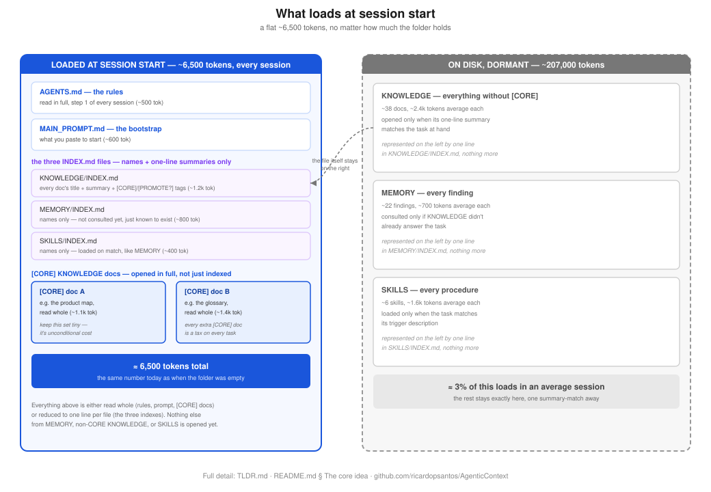
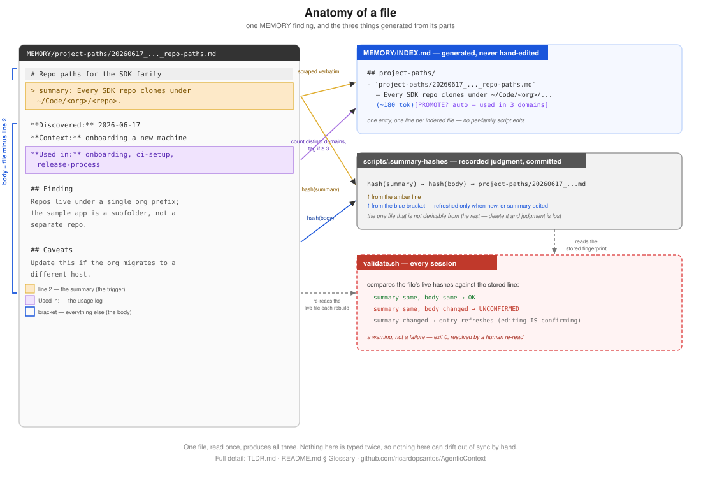
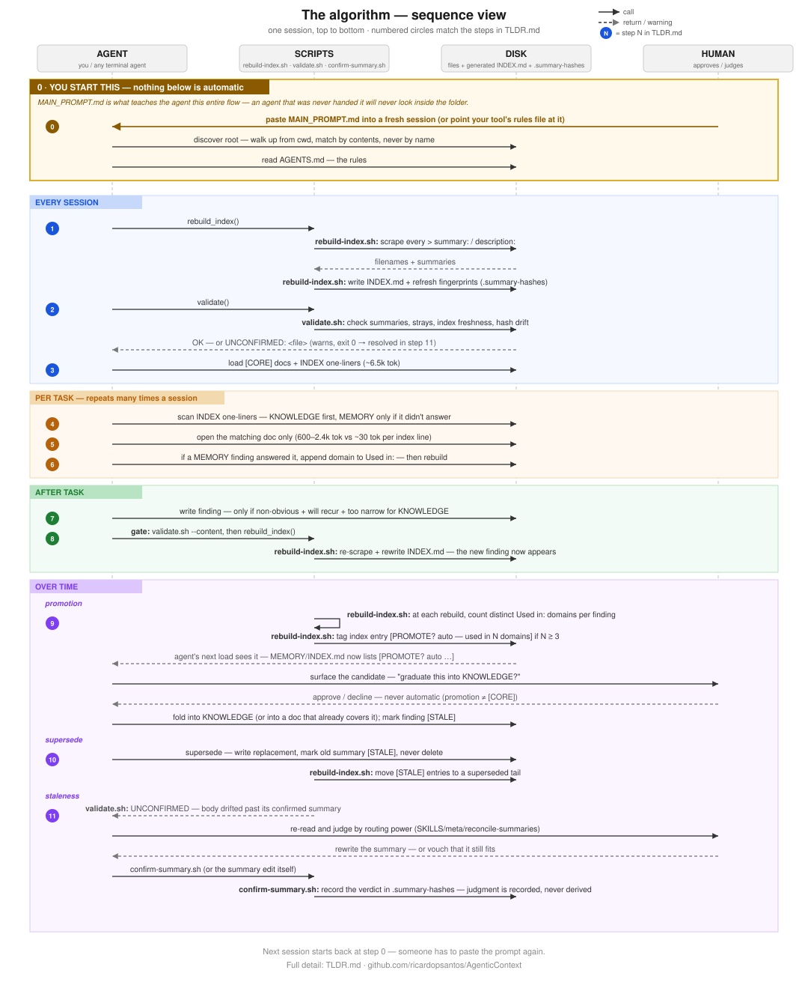

# `.agentic_context`: agent context system

A small, portable scaffold that gives a terminal AI coding agent durable,
self-maintaining context for a large, long-running project. Plain markdown and
a few small shell scripts: no database, no embeddings, no plugins. Only the folder
*contents* and the `INDEX.md` files change per project; everything else (the
`SKILL.md` skeletons, the scripts, the main prompt) travels unchanged.

Agent-agnostic by construction. Nothing here calls a model API or depends
on a vendor SDK: it's markdown your agent reads and shell scripts it runs. If
your tool can read files and run commands, it works, whether that's Claude Code,
GitHub Copilot CLI, Codex CLI, Gemini CLI, Cursor, Aider, or whatever replaces
them. See [Using it with any agent](documents/REFERENCE.md#using-it-with-any-agent).

*What this is, why it exists, and the whole algorithm on one page. For the install command, the glossary, and the full day-to-day reference, see [documents/REFERENCE.md](documents/REFERENCE.md).*

*Index*

- [The problem](#the-problem)
- [How it works](#how-it-works)
- [The scripts](#the-scripts)
- [The algorithm](#the-algorithm)
  - [Every session](#every-session)
  - [Per task](#per-task)
  - [After task](#after-task)
  - [Over time](#over-time)
  - [The same thing, as pseudocode](#the-same-thing-as-pseudocode)

---

## The problem

Every session your agent starts from zero. It re-greps the same code, re-reads the same files, and re-discovers the same gotchas, the ones that cost you a debug session the first time. On a big codebase that's 30k to 60k tokens burned before any new work happens.

Why notes don't fix it. Two failure modes. A notes file big enough to be useful is too big to paste, and it buries the one fact you need under fifty you don't. Worse, hand-maintained indexes drift the moment a file gets renamed, and the agent trusts them anyway. A confidently wrong map is worse than no map.

## How it works

Three folders, split by behavior. `KNOWLEDGE/` is stable reference: a small `[CORE]` subset loads every session, the rest on demand. `MEMORY/` is findings you only learn by hitting them, timestamped, never loaded upfront. `SKILLS/` is reusable procedures, loaded when the task matches. Different behavior, so different loading rules. A fourth, optional folder, `POLICIES/`, holds your own extra rule files; every `.md` in it is read each session, like `AGENTS.md`.

Here is exactly what that means at session start: a flat, small set loaded in full, and everything else left dormant on disk.



Every file describes itself. Line 1 is the title, line 2 is a one-line `> summary:`, and an optional line 3 `> keywords:` holds extra search words (error text, IDs, old names) that are searched but never loaded. Skills get it free, since their frontmatter `description:` *is* the summary. That line isn't an abstract, it's a trigger: it's the only thing read to decide whether opening the file is worth it. An index entry costs about 30 tokens; the file itself costs 600 to 2,400.

One file, and the three things generated from its parts: the index entry, the fingerprint, and the staleness check.



The index is generated, never written. [`rebuild-index.sh`](https://github.com/ricardopsantos/AgenticContext/blob/main/.agentic_context/scripts/rebuild-index.sh) walks the folders, scrapes each file's summary line, and rewrites all three `INDEX.md` from scratch. The summary lives inside the file it describes, which is the single source of truth, and the index is a disposable derivative. Add a file, rebuild, it appears. Delete one, rebuild, it's gone. Because the index is a pure function of disk, it *cannot* disagree with disk. That's the decision everything else hangs off.

The safety net. [`validate.sh`](https://github.com/ricardopsantos/AgenticContext/blob/main/.agentic_context/scripts/validate.sh) flags files missing a summary, summaries spilling to a second line, files sitting where the index script can't see them, and any index older than what it describes. Truthfulness is checked, not hoped for.

Promotion, by evidence. Findings start in MEMORY because at discovery you can't tell a local quirk from a project-wide fact. Each finding records the domains it gets used in, and at three distinct domains the rebuild nominates it. The test is generality rather than frequency: a daily gotcha inside one module stays put, while a rare but project-wide fact moves up. A human approves the move, because promotion adds to the always-loaded core, and that core only works while it stays small.

Why it scales. On the deployment we measured, the knowledge folder is 214k tokens and no longer fits in a context window at all. Per-session load: about 6,500 tokens, flat. Each new document adds ~47 tokens to a session, because the index grows by one line, not by the document. Awareness of everything at ~2% of its cost, and that ratio holds as the folder grows for years. At that scale (33 repos, ~4.6M tokens of source) it works out to ~78% cheaper orientation, with break-even on the first reused fact.

The honest limit. A script can guarantee every file has a summary. It can't judge whether that summary is still true after the body changes. So the rebuild fingerprints summary and body separately, and validation warns `UNCONFIRMED` when they drift, flagging that a human judgment is due instead of faking one. Automate what's mechanical, detect the rest.

Two of those states, STALE and UNCONFIRMED, aren't exclusive to MEMORY or to KNOWLEDGE: both apply to either side alike. This is what that looks like as a Venn diagram: MEMORY-only states on the left, KNOWLEDGE-only states on the right, and the two shared states sitting in the overlap.


No database, no embeddings, no plugins. Three folders, a few shell scripts, plain markdown.

## The scripts

Everything the agent does mechanically is a plain `bash` script in `scripts/`. They self-locate, so the agent runs them by path from anywhere. The rule behind all of them: a script does what is mechanical and *reports* what needs judgment; it never fakes the judgment.

| Script | What it does | Why it exists |
|---|---|---|
| `rebuild-index.sh` | Regenerates the three `INDEX.md` files (and the search catalogues `MEMORY/INDEX.full.md` and `KNOWLEDGE/INDEX.full.md`, which also carry the `> keywords:` lines) from each file's own `> summary:` line; writes atomically. | The index is derived, so it can never disagree with the disk. |
| `validate.sh` | Read-only integrity check: missing or multi-line summaries, strays the index can't see, stale indexes, unconfirmed summaries, broken supersede links, `SLUGS.tsv` rows with no folder (and the reverse). Warns (never fails) on over-long summaries (KNOWLEDGE 200 characters, skill descriptions 300, new MEMORY findings 300; `> keywords:` lines 150), on a passed `**Verify-by:**` date, and on a system file that changed without a version bump. Exit code 0 or 1; `--content` skips the freshness check. | Fail loudly at the start of a session instead of building on a broken map. |
| `confirm-summary.sh` | Records that you re-read a doc and its summary still fits, by updating its body fingerprint. | The one judgment call in the system, made explicit and logged instead of skipped. |
| `bootstrap.sh` | The whole session start in one call: pull (when the folder is a git clone), rebuild, validate, the list of files to read, open handoffs, then the stats. | One tool call instead of four, and the stats come last so the agent can paste them. |
| `memory-find.sh` | Keyword search (all words must match, case-insensitive, 15 hits max) over `MEMORY/INDEX.full.md`; when no index line matches it searches the finding bodies (marked `[body]`). `--knowledge` searches KNOWLEDGE docs instead, through `KNOWLEDGE/INDEX.full.md`. Slugs described as `[ARCHIVE]` in `SLUGS.tsv` are skipped unless `--all`. Appends each search to a usage log. | The agent finds the one finding it needs without ever loading the catalogue, even when the summary used other words. |
| `usage-report.sh` | Summarises that log: search count, top queries, and queries that found nothing; `--today` lists only today's misses and body-only hits. | Zero-hit searches show where the memory has a gap; body-only hits show which summaries need a `> keywords:` line. |
| `mark-used.sh` | Adds a domain to a finding's `**Used in:**` line (creating it if absent, never duplicating). | Usage tracking feeds auto-promotion; one command instead of hand-editing. |
| `bump-version.sh` | Bumps `VERSION`, writes a `CHANGELOG.md` entry, stamps the prompt title and rewrites the system-file manifest (`--restamp`: only the last two). | The system has one version, and the scripts keep it honest (see [Versioning](#versioning)). |
| `lib.sh` | Sourced, never run: reads every doc's header fields and hashes in a few passes. | `rebuild-index.sh` and `validate.sh` take seconds at hundreds of docs, not minutes. |
| `set-slug.sh` | Adds or replaces one row of `MEMORY/SLUGS.tsv`, sorted and tab-clean; refuses anything that is not a plain folder name under `MEMORY/`. | A hand-written one-line scope per MEMORY folder, without editing a tab file by hand. |
| `stats.sh` | Folder and file counts and sizes, plus the **bootstrap load**: every file read at session start with its estimated token cost (bytes / 4). | Makes the cost of the always-loaded set visible every session, and warns when the bootstrap prompt names a file the table does not count. |
| `test-rebuild-index.sh`, `test-stats.sh` | Regression tests for the behaviour above, one numbered requirement per check. | The scripts are what keep the context honest, so they are tested like code. |

### Versioning

The system has one version: the `VERSION` file (`X.Y.Z`) with its history in `CHANGELOG.md`. It covers the files that travel unchanged between installs (the scripts, the three folder `SKILL.md` skeletons, `REQUIREMENTS.md`, the bootstrap prompt), not your docs and findings, which git already versions. No file carries a hand-written version line: per-file versions drift, and the indexes are rebuilt on every machine. Instead the scripts stamp it. Every `INDEX.md` header and the prompt's title say `System vX.Y.Z`, and `stats.sh` prints it each session. After changing a system file you run `bump-version.sh` (patch = fix, minor = new script, check or field, major = a format change that needs existing content migrated); it also rewrites `scripts/.system-manifest`, the hash list `validate.sh` uses to warn about a system file changed without a bump. Comparing two installs is comparing their `VERSION` files.

### Why MEMORY has a slim index

An index with one line per finding is fine at 50 findings and a tax at 400. On the deployment measured here, MEMORY grew to roughly 390 findings, and the one-line-each catalogue reached about 45k tokens. That is more than the whole rest of the session-start load, paid in every session, for findings that almost no session needs.

So MEMORY is two-tier:

- **`MEMORY/INDEX.md`** (loaded every session, about 400 tokens): one line per `MEMORY/<slug>/` folder with its finding count and a one-line scope, plus any `[PROMOTE?]` candidates. It answers "does this memory have an area that could matter?".
- **`MEMORY/INDEX.full.md`** (never loaded whole): every finding's summary. It exists to be searched. `memory-find.sh timeout llama` returns the matching lines and the agent opens a finding only if its summary fits.

The slug, which is just the folder name, gets its scope from `MEMORY/SLUGS.tsv` (`slug<TAB>description`) because a folder name cannot describe itself. That file is hand-written on purpose: if the rebuild appended rows automatically, two machines sharing the repo would each append the same row and conflict on the next pull. `validate.sh` warns when a folder has no row or a row has no folder, and `set-slug.sh` is the safe way to edit it. KNOWLEDGE and SKILLS keep full indexes: they are small, curated, and read by summary match.

### What earns `[CORE]`

Every `[CORE]` KNOWLEDGE doc is loaded in full, every session, which is why `stats.sh` lists them one by one. A doc earns the tag only when missing it causes a severe failure that has already recurred: a security bug that shipped four times, a rule that must hold on every task. A narrow trigger with a mild failure ("read before adding a concurrency gate; the worst case is a slot leak that a restart clears") is not CORE; its summary already tells the agent when to open it. The tag is always the human's decision, never the agent's.

---

## The algorithm

*One rule underneath all of it: files are the source of truth, indexes are derived. The agent reads the map but never draws it.*

The steps below as a sequence diagram, showing who calls whom: the agent, the
scripts, disk, and the human who has the only vote on promotion and staleness.



### Every session

Steps 1 to 3 below are a single call, `scripts/bootstrap.sh`: it pulls (when the folder is a git clone), rebuilds, validates, lists the files to read and any open handoffs, and prints the stats last.

0. You start it: paste the session bootstrap. Everything below only happens because you open every agent session by pasting [MAIN_PROMPT.md](https://github.com/ricardopsantos/AgenticContext/blob/main/MAIN_PROMPT.md) (or pointing your tool's auto-loaded rules at it). The prompt then finds the root on its own: walk up from the working directory and match the context folder by what it *contains* (`scripts/rebuild-index.sh` + `KNOWLEDGE/`), never by name. Nothing hardcoded, so the folder can be called anything. Then it reads the rules (`AGENTS.md`).
1. Self-heal first. Rebuild the indexes from disk *before* reading them. A map regenerated from the territory can't be out of date.
2. Validate. If a file lost its summary, or sits where the script can't see it, fail loudly now. Don't build on a broken index.
3. Load small, then show the bill. The rules file, the three index one-liners (MEMORY's is only a slug map, see [The scripts](#the-scripts)), and the `[CORE]` docs. Nothing else. Then `stats.sh` prints the exact bootstrap load, file by file, and the agent pastes it into its reply so you can see what the session cost before any work starts. ~6,500 tokens on the deployment measured for this document, flat as the folder grows; it climbs only when you tag more docs `[CORE]`.

### Per task

4. Scan, don't open. Match the task against the index one-liners. KNOWLEDGE first; consult MEMORY only if KNOWLEDGE didn't answer.
5. Open on match only. A summary is a trigger, not an abstract. It's the sole basis for deciding whether the file is worth its 600 to 2,400 tokens.
6. Record the hit. When a finding answers a task, run `mark-used.sh <finding> <domain>`, which adds that domain to its `Used in:` line. This is what turns promotion into evidence.

### After task

7. Write what you learned, but only if it's non-obvious, will recur, and is too narrow for KNOWLEDGE. Never official-doc facts, one-off context, or secrets. One finding, one file, timestamped, summary on line 2.
8. Rebuild. The new finding appears in the index because it's on disk, not because anyone listed it. The one hand-written exception is a brand-new `MEMORY/<slug>/` folder: it gets a one-line scope with `set-slug.sh`, because a folder name can't describe itself.

### Over time

9. Promote on evidence. At three or more distinct domains in `Used in:`, the rebuild nominates a finding. The test is generality, not frequency. A human approves, because promotion grows the always-loaded core and that core only works while it's small. Once folded into KNOWLEDGE, the finding is marked `[STALE]`.
10. Supersede, never delete. The replacement goes in, the old summary gets `[STALE]`, and it drops to a "skip unless auditing" tail. You keep the trail of what you once believed.
11. Re-confirm meaning. Bodies drift from summaries. Fingerprint both; when they diverge, warn `UNCONFIRMED` and make a human re-read and decide.

### The same thing, as pseudocode

```
on session_start:
    root = discover_root()          # find it, don't assume it
    read(AGENTS.md)                 # the rules
    rebuild_index()                 # self-heal BEFORE reading
    if not validate(): stop()       # never build on a broken map
    load(CORE_docs + INDEX summaries)

on task:
    hits = scan(INDEX one-liners, task)          # ~30 tokens each
    for doc in hits where summary matches task:
        open(doc)                                # 600-2,400 tokens
        if doc in MEMORY and doc answered task:
            doc.used_in += task.domain
            rebuild_index()

on task_end:
    if learned(x) and non_obvious(x) and recurs(x) and too_narrow_for_KNOWLEDGE(x):
        write(MEMORY/<slug>/<timestamp>_<topic>.md, summary=line_2(x))
        rebuild_index()

on rebuild_index:                   # the load-bearing function
    for folder in [KNOWLEDGE, MEMORY, SKILLS]:
        INDEX[folder] = [scrape_summary(f) for f in walk(folder)]
        # pure function of disk => cannot disagree with disk
    fingerprint(summary, body)      # for staleness detection

on promotion_check:                 # inside rebuild
    if count(distinct(finding.used_in)) >= 3:
        nominate(finding)           # nominate; never decide
        # human approves -> fold into KNOWLEDGE, mark finding [STALE]

on validate:
    assert every file has a one-line summary
    assert no file is invisible to the index script
    assert every INDEX newer than what it describes
    warn UNCONFIRMED where body_hash drifted past confirmed_summary_hash
```

## AI disclosure

Parts of this project were written with the assistance of AI coding agents
(Claude Code). All changes are reviewed by the maintainer, who is responsible
for the code. This is the single place that fact is disclosed; it is
deliberately kept out of the commit history.

---

*The long-form story: [The Index That Can't Lie](https://ricardojpsantos.medium.com/the-index-that-cant-lie-how-we-gave-claude-code-a-memory-that-maintains-itself-614340266577) on Medium.*
