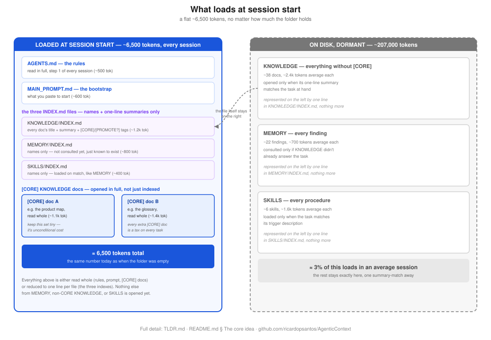
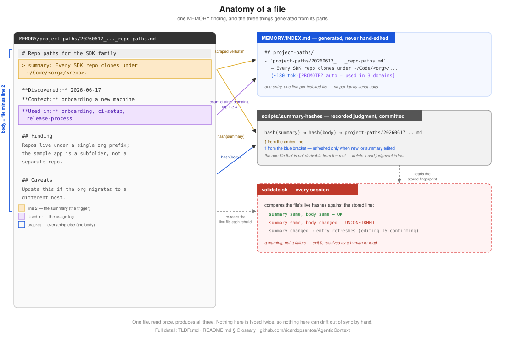
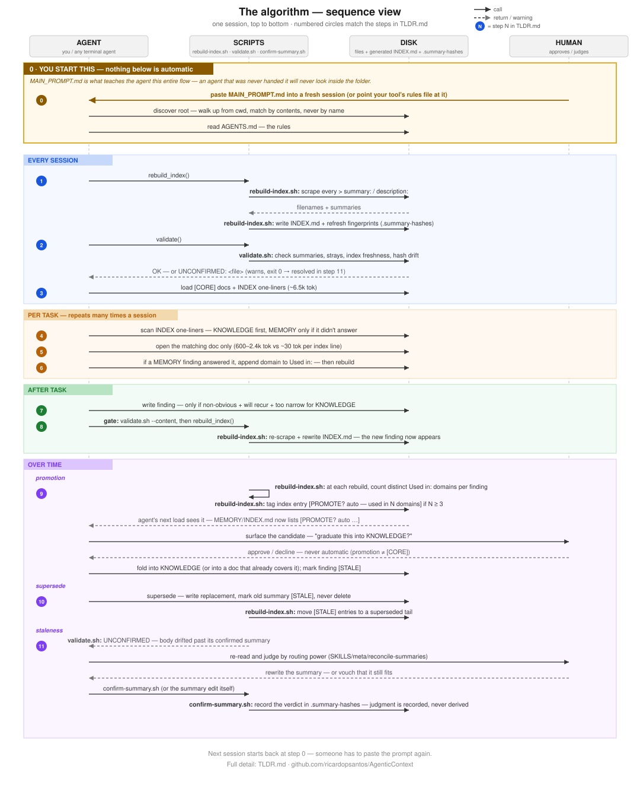

# `.agentic_context` — agent context system

A small, portable scaffold that gives a terminal AI coding agent durable,
self-maintaining context for a large, long-running project. Plain markdown and
a few small shell scripts: no database, no embeddings, no plugins. Only the folder
*contents* and the `INDEX.md` files change per project; everything else (the
`SKILL.md` skeletons, the scripts, the main prompt) travels unchanged.

Agent-agnostic by construction. Nothing here calls a model API or depends
on a vendor SDK: it's markdown your agent reads and shell scripts it runs. If
your tool can read files and run commands, it works, whether that's Claude Code, GitHub
Copilot CLI, Codex CLI, Gemini CLI, Cursor, Aider, or whatever replaces them.
See [Using it with any agent](#using-it-with-any-agent).

This is the deep reference: install, the glossary, every script, and the
full mechanics of promotion. New here? [README.md](../README.md) is the
one-pager: the problem, how it works, why the per-session cost stays flat as
the folder grows, and the whole algorithm end to end (including as
pseudocode and two diagrams).

Running into a tag like `[STALE]` or a warning like `UNCONFIRMED` in your
indexes? See the [Glossary](#glossary).

---

## Index

- [Glossary](#glossary)
- [The problem this solves](#the-problem-this-solves)
- [Install](#install)
- [The three folders](#the-three-folders)
- [The core idea: tiered, lazy, self-describing](#the-core-idea-tiered-lazy-self-describing)
  - [`[CORE]` and `[PROMOTE?]` tags](#core-and-promote-tags)
- [Why the index is *derived*, never hand-written](#why-the-index-is-derived-never-hand-written)
- [`scripts/`](#scripts)
- [How a session runs](#how-a-session-runs-see-main_promptmd)
- [Using it with any agent](#using-it-with-any-agent)
- [Adding things](#adding-things)
- [Meta skills: the framework about itself](#meta-skills-the-framework-about-itself)
- [Promotion: MEMORY → KNOWLEDGE](#promotion-memory--knowledge)
  - [What it is](#what-it-is)
  - [The test: generality, NOT frequency](#the-test-generality-not-frequency)
  - [Why a human confirms it (not automatic)](#why-a-human-confirms-it-not-automatic)
  - [How to do it](#how-to-do-it)
- [License](#license)

---

## Glossary

The tags and warnings you'll see in an index or a [`validate.sh`](https://github.com/ricardopsantos/AgenticContext/blob/main/.agentic_context/scripts/validate.sh) run,
what each one means, and where it comes from. Hand-written tags (`[CORE]`,
`[PROMOTE?]`) go in a doc's own summary line, never into an index. The index
entries themselves are always machine-written by [`rebuild-index.sh`](https://github.com/ricardopsantos/AgenticContext/blob/main/.agentic_context/scripts/rebuild-index.sh).

| Term | Appears in | Meaning |
|---|---|---|
| `[CORE]` | A KNOWLEDGE summary | Always load this doc at session start. Hand-added by you when a doc is relevant to almost every task. Keep this set tiny; it's the one thing every session pays for unconditionally. |
| `[PROMOTE?]` | A MEMORY summary | Hand-flagged by a human: "I think this finding is broadly useful, consider moving it to KNOWLEDGE." A suggestion, not a rule. |
| `[PROMOTE? auto — used in N domains]` | A MEMORY index entry | Machine-generated by `rebuild-index.sh`, never written into the file itself. Appears once a finding's `Used in:` line names 3 or more distinct domains. Evidence of generality, not a hunch; see [Promotion](#promotion-memory--knowledge). |
| `[STALE]` | A MEMORY (or KNOWLEDGE) summary prefix | This item has been superseded, replaced by a newer finding, or folded into a KNOWLEDGE doc that already covers it. The rebuild script moves `[STALE]` entries out of the active list into a "superseded" tail section at the bottom of the index. Nothing is ever deleted; this is how retirement looks. |
| `SLUGS.tsv` | `MEMORY/SLUGS.tsv` | One `slug<TAB>description` row per `MEMORY/<slug>/` folder (a slug is just the folder name). Hand-written via `set-slug.sh`; feeds the scope text in the slim `MEMORY/INDEX.md`. Missing or orphan rows are warnings. |
| `INDEX.full.md` | `MEMORY/` | The per-finding catalogue (one summary line each). Never loaded whole; searched with `memory-find.sh`. |
| `UNCONFIRMED` | `validate.sh` output | A warning, not an error: `validate.sh` still exits 0. It means a doc's *body* changed since its `> summary:` line was last confirmed, so the summary might no longer describe the doc accurately. Resolve it by re-reading the doc and either rewriting the summary or running `scripts/confirm-summary.sh <path>` to vouch that it still fits. |
| `Used in:` | A MEMORY finding's own metadata | A log line the agent appends to, one domain per task the finding answered. This is what feeds the auto-`[PROMOTE?]` count above; see [Promotion](#promotion-memory--knowledge). |
| `> summary:` | Line 2 of every KNOWLEDGE/MEMORY doc | The one-line self-description everything else is built on. What `rebuild-index.sh` scrapes to build the indexes; what `validate.sh` checks exists; what gets fingerprinted for the `UNCONFIRMED` check. |

---

## The problem this solves

An agent only knows what's in its context window. On a big project that grows
over months, two things go wrong:

1. Context doesn't persist. Findings discovered in one session are gone by
   the next unless something stores them.
2. Stored context rots. The moment you keep a hand-maintained list of "what
   we know," it drifts out of sync with reality: files get renamed, added, or
   deleted and the list lies. A confidently-wrong index is worse than none.

The whole design is a response to #2. Almost every choice here exists to make
drift *impossible by construction* rather than *avoided by discipline*.

---

## Install

From your project root:

```bash
curl -fsSL https://raw.githubusercontent.com/ricardopsantos/AgenticContext/main/Auxiliar/install.sh | bash
```

Needs only `curl` and `tar`. It creates the context folder (skeleton, scripts,
meta-skills, dummy example docs marked "delete me"), then builds the indexes and
validates the install. It refuses to overwrite an existing install.

The folder name is yours. It defaults to `.agentic_context`, and on a
terminal the installer asks for the name and whether to hide it. Or pass flags:

```bash
curl -fsSL <same-url> | bash -s -- /path/to/project [options]

  --dir <name>   context folder name, used verbatim (default: .agentic_context)
  --visible      drop the leading dot, so the folder isn't hidden
  --force        overwrite an existing install
  --yes          never ask; take the defaults
  --from <path>  migrate KNOWLEDGE/MEMORY/SKILLS from a previous install
  --in-place     with --from elsewhere: relocate the fresh install onto it
```

`curl | bash` hands the script its own stdin, so the questions are read from
`/dev/tty`; with no terminal (CI, redirected stdin) it takes the defaults
rather than hanging.

Nothing gets patched to match your choice, because the prompt identifies its
root by what the folder *contains* (`scripts/rebuild-index.sh` + `KNOWLEDGE/`),
not by what it's called. `.agentic_context`, `agentic_context`, `brain`,
`notes` all work, and you can rename the folder later without editing anything.

### Upgrading — the system evolves, and you can pull the evolution in

(Check `VERSION` before and after: `cat .agentic_context/VERSION`.)

The framework itself (scripts, `MAIN_PROMPT.md`, `meta/` skills) improves over
time — bugfixes, new checks, new capabilities. Re-running the installer is how
you pick that up, without losing what you've built: your `KNOWLEDGE/`,
`MEMORY/`, and project-specific `SKILLS/` are never framework code, so a fresh
install can always replace the framework parts around them.

**Migrating into a new/renamed install.** Pass `--from <path>` pointing at an
old install's context folder (or leave it blank on a terminal prompt — it
offers the right default automatically), and the new install carries over
`KNOWLEDGE/`, `MEMORY/`, and every `SKILLS/` category except `meta/` (that
stays framework-fresh) instead of seeding dummy examples. It also copies
`scripts/.summary-hashes`, so any doc that was already flagged `UNCONFIRMED`
in the old install stays flagged — migrating doesn't silently mark it
confirmed.

```bash
# Example: bring an old install's content into a differently-named new one
curl -fsSL <install-url> | bash -s -- /path/to/project --dir .agentic_context_v2 --from /path/to/project/.agentic_context
```

**Upgrading in place.** The common case is simpler: you just want to re-run
the installer *on the same project* to pick up the latest framework, keeping
everything you wrote. Point `--from` at the install's own location (or, on a
terminal, just press Enter when it detects one there) — the installer backs
it up to `<path>.bak-<timestamp>`, installs the current framework fresh, and
migrates your content straight back in. No `--force` needed; the backup makes
it non-destructive.

```bash
# Example: upgrade the install already sitting in this project
cd /path/to/project
curl -fsSL <install-url> | bash -s -- --from .agentic_context --yes
```

If the old install lives somewhere else and you want the fresh install to
*take over its name and location* rather than sit at a new one, add
`--in-place`: it backs up the old path the same way, then moves the freshly
built (and already-migrated) install onto it.

To install from a local clone instead: [`./Auxiliar/install-local.sh`](https://github.com/ricardopsantos/AgenticContext/blob/main/Auxiliar/install-local.sh) `<target-dir>`
(same options).

Installing is not enough. Every session must start with the bootstrap.
The system does nothing passively: an agent that wasn't told about it will
never look inside the folder. Paste the installed `MAIN_PROMPT.md` as the
first message of every agent session (or point your tool's auto-loaded
rules file at it). That prompt is what makes the agent rebuild the indexes,
load the core, and consult MEMORY. Skip it and you're running a plain
amnesiac session next to a folder it ignores. See
[How a session runs](#how-a-session-runs-see-main_promptmd).

---

## The three folders

Context is split by *how it behaves*, not by topic:

- `KNOWLEDGE/`: static, authoritative reference. Ground truth that rarely
  changes (architecture, product maps, glossaries). Treated as fact. Has a small
  always-loaded core (`[CORE]`).
- `MEMORY/`: session-learned findings. Non-obvious gotchas/quirks/fixes
  discovered while working. Narrow, timestamped, written at discovery time.
  Never loaded upfront, only dug up on demand.
- `SKILLS/`: how-to guides. Reusable procedures (build/release, Swift
  concurrency patterns, testing strategy).

Reference vs. findings vs. procedures. Keeping them separate is what lets each
have its own load policy.

---

## The core idea: tiered, lazy, self-describing

The agent should *not* load everything every session. That bloats context and
drowns the relevant in the irrelevant. Instead:

- At session start it loads only small index files plus a tiny always-on
  core. Everything else is loaded on demand, only when relevant.
- Each item describes itself in one line. KNOWLEDGE and MEMORY docs carry a
  `> summary:` line as line 2; skills use their frontmatter `description:`.
  That one line is the trigger the agent reads to decide whether to open the
  full file.

Concretely, this is what's in context the moment a session starts,
next to everything that stays on disk until a summary matches:



This is the "load descriptions, not just names" principle: a bare filename like
`init-order.md` is a weak signal; a one-line summary lets the agent reliably
decide what to dig into.

### `[CORE]` and `[PROMOTE?]` tags

- `[CORE]` in a KNOWLEDGE summary = always load this at session start (it's
  relevant to almost every task). Keep this set *tiny*: it's the one thing that
  loads unconditionally.
- `[PROMOTE?]` in a MEMORY summary = this finding looks broadly applicable and
  is a candidate to graduate into KNOWLEDGE (see "Promotion" below).

---

## Why the index is *derived*, never hand-written

The single most important decision. The summary lives inside each file (the
source of truth). The `INDEX.md` files are generated from those summaries by
a script. The agent reads the index; it never authors it.

Consequence: the index is a pure function of what's on disk, so it *cannot*
disagree with reality. Add a doc → rebuild → it appears. Delete a doc → rebuild
→ it's gone. Edit a summary → rebuild → the index updates. The index is
disposable; one command recreates it perfectly. This is what kills the drift
problem at the root instead of asking a human to remember to keep a list current.

The rejected alternative, meaning "let the agent write entries straight into the
index," feels convenient but reintroduces drift: the summary then exists only
in the index, can't be regenerated, and won't update when the doc changes.

---

## `scripts/`

- [`rebuild-index.sh`](https://github.com/ricardopsantos/AgenticContext/blob/main/.agentic_context/scripts/rebuild-index.sh): regenerates all three `INDEX.md` from the source
  summaries (`> summary:` lines for docs, frontmatter `description:` for skills).
  Each entry also gets an estimated context cost (`~N tok`, size ÷ 4), and MEMORY
  entries with ≥3 distinct `**Used in:**` domains are auto-tagged
  `[PROMOTE? auto]`. Run after any content change; also run on session init as a
  self-heal.
- [`validate.sh`](https://github.com/ricardopsantos/AgenticContext/blob/main/.agentic_context/scripts/validate.sh): read-only integrity check; exits non-zero on problems.
  Flags: docs with missing/empty/multi-line `> summary:`, skills missing
  `description:`, malformed `**Used in:**` lines, stray files the index script
  can't see (docs at a folder root, skill folders without a `SKILL.md`), and any
  `INDEX.md` older than the content it describes. It also *warns* (never fails)
  on over-long summaries (KNOWLEDGE 200 characters, skill descriptions 300, new
  MEMORY findings 300; older findings are only counted), on a passed
  `**Verify-by:** YYYY-MM-DD` date, and on a system file changed without a version
  bump. `--content` runs only the
  content checks; use it as a gate right after writing a file, since the
  freshness check would flag a false STALE before the next rebuild. The full
  run also *warns* (never fails) on semantic staleness: any doc whose body
  changed since its summary was last confirmed (see below).
- [`confirm-summary.sh`](https://github.com/ricardopsantos/AgenticContext/blob/main/.agentic_context/scripts/confirm-summary.sh) `<file>…`: records the judgment "I re-read this doc
  and its summary still fits" after a body-only edit, so validate stops
  flagging it. Editing the summary line itself confirms implicitly.

- [`stats.sh`](https://github.com/ricardopsantos/AgenticContext/blob/main/.agentic_context/scripts/stats.sh): read-only size and count report for the three
  folders, then the **bootstrap load**: every file the session reads at start
  (the bootstrap prompt, the rules, the three `SKILL.md` and `INDEX.md`, each
  `[CORE]` doc) with its estimated token cost (bytes ÷ 4) and a total. Optional
  files (every `POLICIES/*.md`, `~/FOLDER-INDEX.md`) are counted only if the
  install has them. It warns when the bootstrap prompt names a root-level `.md`
  file the table does not cover. The agent pastes the whole output into its
  reply: tool output is not shown to the user, so this is how the user sees what
  the session cost.
- [`bootstrap.sh`](https://github.com/ricardopsantos/AgenticContext/blob/main/.agentic_context/scripts/bootstrap.sh) `[--no-pull]`: the session start in one call. Pulls
  (`--rebase --autostash`, only when the folder is a git clone with a remote),
  rebuilds the indexes, runs `validate.sh` (findings and verdict only), lists the
  absolute paths to read, lists open handoffs (`MEMORY/handoff/` findings whose
  summary does not start with `[STALE`), then prints `stats.sh` last. Exits
  non-zero when the pull or the validation fails.
- [`memory-find.sh`](https://github.com/ricardopsantos/AgenticContext/blob/main/.agentic_context/scripts/memory-find.sh) `[--all] <keyword>…`: searches `MEMORY/INDEX.full.md`
  (case-insensitive, every keyword must match, 15 hits max, one trimmed line each).
  When no index line matches it searches the finding files themselves and marks
  those hits `[body]` (the summary lacked the words: add a `**Keywords:**` line,
  which the index shows as ` [kw: …]`). Slugs whose `SLUGS.tsv` description starts
  with `[ARCHIVE]` are skipped unless `--all`, and the output says how many hits
  that hid. Each search appends `date<TAB>keywords<TAB>hit-count<TAB>mode` to
  `$AGENTIC_USAGE_LOG` (default `~/.agentic-context-usage.log`); a logging failure
  never fails the search.
- [`usage-report.sh`](https://github.com/ricardopsantos/AgenticContext/blob/main/.agentic_context/scripts/usage-report.sh) `[--today]`: summarises that log: search count,
  top queries, and queries with zero hits (the gaps in the memory). `--today`
  lists only today's zero-hit and body-only searches, for the session debrief.
- [`mark-used.sh`](https://github.com/ricardopsantos/AgenticContext/blob/main/.agentic_context/scripts/mark-used.sh) `<finding> <domain>`: adds the domain to the finding's
  `**Used in:**` line, creating it when absent (after `Context`/`Discovered`),
  never duplicating (case-insensitive); refuses a file outside `MEMORY/<slug>/`.
- MCP clients get the same search as the `find_memory` tool (see `mcp_server/README.md`).
- [`set-slug.sh`](https://github.com/ricardopsantos/AgenticContext/blob/main/.agentic_context/scripts/set-slug.sh) `<slug> "<description>"`: adds or replaces one row of
  `MEMORY/SLUGS.tsv`, sorted and tab-clean; refuses an empty slug, a slug with `/`,
  or one with no folder. Editing the file makes `MEMORY/INDEX.md` stale until the
  next rebuild.
- [`bump-version.sh`](https://github.com/ricardopsantos/AgenticContext/blob/main/.agentic_context/scripts/bump-version.sh) `<major|minor|patch|X.Y.Z> "<line>"`: bumps `VERSION`,
  prepends a dated `CHANGELOG.md` entry, rewrites the bootstrap prompt's title to end
  `(system vX.Y.Z)` and rewrites `scripts/.system-manifest`. `--restamp` does only the
  last two, for a copy of the system made for another install. See *Versioning*.
- [`lib.sh`](https://github.com/ricardopsantos/AgenticContext/blob/main/.agentic_context/scripts/lib.sh): sourced by `rebuild-index.sh` and `validate.sh`, never run. Reads
  every doc's header fields and hashes in a few passes instead of a few processes per
  doc, which is what keeps both scripts at seconds for ~700 docs (it was ~80 s).
  Copy the whole `scripts/` folder: the two scripts stop with a clear message if it is missing.
- [`test-rebuild-index.sh`](https://github.com/ricardopsantos/AgenticContext/blob/main/.agentic_context/scripts/test-rebuild-index.sh) and [`test-stats.sh`](https://github.com/ricardopsantos/AgenticContext/blob/main/.agentic_context/scripts/test-stats.sh):
  regression tests, one numbered requirement per check (R1 to R33 in `.agentic_context/REQUIREMENTS.md`).
  The installers copy them too: they are small and nothing loads them.

All of them `cd` to the context root first, so they work from anywhere and always
write indexes at the root.

### Versioning

The system has one version, the `VERSION` file (`X.Y.Z`), with its history in
`CHANGELOG.md` (not to be confused with this repo's own `documents/CHANGELOG.md`,
which tracks the framework and its tools for users). It covers the files that
travel unchanged between installs: `scripts/*.sh`, the three folder `SKILL.md`
skeletons, `REQUIREMENTS.md` and the bootstrap prompt. KNOWLEDGE, MEMORY and your
own skills are content, versioned by git alone. There is deliberately no version
line inside each file: per-file versions drift because nobody bumps them, and the
`INDEX.md` files are rebuilt on every machine, so a hand-kept line there would only
add merge conflicts. Instead the scripts stamp it: the version is in every
`INDEX.md` header, in the prompt's title and in the `stats.sh` output of every
session.

After changing a system file, add the requirement and its test, then run
`scripts/bump-version.sh <patch|minor|major> "<what changed>"` (patch = fix, minor =
a new script, check or field, major = a format change that needs existing content
migrated) and rebuild. `validate.sh` warns until you do, by comparing each system
file with the hash in `scripts/.system-manifest`. To compare two installs, compare
their `VERSION` files.

**Keeping a source repo in step with a live install.** If you develop the system in
one place and publish from another, `Auxiliar/sync-from-live.sh <live-root>` copies
the system files across, applies the public variant (usage-log path), refuses to continue if a private
string is in the copied files, restamps the manifest, then rebuilds, validates and
tests. The installers and `publish-public.sh` copy every file in `scripts/`, so a
new script ships the moment it exists.

### The slim MEMORY index

`rebuild-index.sh` writes MEMORY twice. `MEMORY/INDEX.full.md` holds one line per
finding and is never loaded whole; `MEMORY/INDEX.md` is a slug map (one line per
`MEMORY/<slug>/` folder: finding count and scope) plus `[PROMOTE?]` candidates,
about 400 tokens instead of tens of thousands. The scope text comes from
`MEMORY/SLUGS.tsv`, a hand-written `slug<TAB>description` file edited through
`set-slug.sh`. The rebuild never writes it (two machines would append the same row
and conflict on the next pull); `validate.sh` warns on a folder with no row and on
a row with no folder. A finding is found with `memory-find.sh`, not by reading the
index. The full index is written first, so `INDEX.md` stays the newest file and the
freshness check holds.

Known limit, and how it's handled: the scripts can't judge whether a
summary is still *accurate*. Accuracy needs a read. But they can detect when
that judgment is *due*: `rebuild-index.sh` keeps `scripts/.summary-hashes`
(per file: summary-line hash + body hash; refreshed when a file is new or its
summary changes, kept when only the body changes), and `validate.sh` warns
`UNCONFIRMED` for any doc whose body drifted past its last-confirmed summary.
Resolving the warning is the judgment step: re-read and either rewrite the
summary or run `confirm-summary.sh` (procedure:
`SKILLS/meta/reconcile-summaries`). The cache is recorded judgment: commit
it; deleting it silently re-confirms everything.

One file, read once, produces all three things above. Nothing is typed twice:



---

## How a session runs (see `MAIN_PROMPT.md`)

Paste `MAIN_PROMPT.md` at the start of every agent session. It's the
mandatory entry point, not an optional extra. It is
bootstrap + load order only: it says *when* to read things; what each folder
*is* lives in that folder's `SKILL.md`. Flow:

0. Discover `<root>`: walk up from the working directory and match each
   ancestor's child folders on *contents*, not name. Nothing is hardcoded and
   nothing is patched at install time, so the prompt is machine-, project- and
   name-independent: paste the same text anywhere, call the folder anything.
1. Read the rules (`AGENTS.md`).
2. Self-heal: run `rebuild-index.sh`, then `validate.sh` (full check).
3. Show the numbers: run `stats.sh` and paste its whole output into the reply (the
   bootstrap load table is the point).
4. Load policy: read the three small indexes (MEMORY's is the slim slug map);
   always-load `[CORE]`; everything else lazy on summary match; search MEMORY with
   `memory-find.sh`, never by reading `INDEX.full.md`.
5. Orient in the project only if a task needs it: scoped and shallow, not a
   full workspace map at init.
6. Per task: before, run `memory-find.sh` (always, when the user says "again" or
   "still"); after, write qualifying findings, give a new MEMORY folder its
   `SLUGS.tsv` row, append the task's domain to any finding's `**Used in:**` line
   that answered, rebuild.
7. On close: if the session did real work, run `SKILLS/meta/session-debrief`.

The same flow as a sequence diagram, showing who calls whom and the two places
where only a human decides:



There is no drift-check step, by design: step 2 rebuilds the indexes from disk
before anything reads them, so an index *cannot* disagree with the tree. A
check for a state the design makes unreachable is dead weight in a prompt
that's pasted every session.

---

## Using it with any agent

The framework needs exactly two capabilities: read a file and run a shell
command. There is no API call, no SDK, no plugin, so any terminal agent can
drive it, and switching tools costs nothing because the context lives in your
repo, not in a vendor's memory feature.

Two things are conventionally tool-specific, and both are one line to adapt:

1. The rules file. `AGENTS.md` is the single source of rules and is already
the cross-tool convention (Codex, Copilot and Cursor read it). Each agent
auto-loads its own filename, so point that filename at `AGENTS.md` rather than
copying rules into it. Two copies drift, which is the exact failure this whole
design exists to prevent. `CLAUDE.md` ships doing precisely that; its entire
contents are:

```
Check `AGENTS.md`
```

Add the equivalent for your tool (`.github/copilot-instructions.md`,
`GEMINI.md`, `.cursor/rules/`, `CONVENTIONS.md`, …). And note that step 1 of
`MAIN_PROMPT.md` tells the agent to read `AGENTS.md` outright, so even a tool
with no auto-load convention picks up the rules.

There is no second caveat. Nothing else here is tied to a particular agent: the
three folders, the derived `INDEX.md` files, the `> summary:` contract, the
scripts, promotion, and the debrief are all plain markdown and bash.

Division of labor: rules that describe a folder's own mechanics live in its
`SKILL.md` (they travel with the folder); rules about session orchestration live
in the main prompt (it's what runs each session). Anything long enough
to have a procedure (the debrief, the summary reconciliation) is a skill the
prompt *points at*, not text the prompt carries. Definitions are written
*once*: duplicating them across prompt and SKILL.md just creates a second copy
to keep in sync.

---

## Adding things

- KNOWLEDGE doc: drop a `.md` in the right family; line 1 `# Title`, line 2
  `> summary: …` (prefix `[CORE]` if always-load); run `rebuild-index.sh`.
- MEMORY finding: `MEMORY/<slug>/YYYYMMDD_HHMMSS_<sub-slug>.md` with a
  `> summary:` line; run `rebuild-index.sh`. Supersede by adding a new file and
  marking the old stale in its Caveats; never delete.
- Skill: `SKILLS/<category>/<name>/SKILL.md` with frontmatter `name:` +
  `description:` (the description is what the index shows; make it
  trigger-worthy); run `rebuild-index.sh`.

---

## Meta skills: the framework about itself

`SKILLS/meta/` holds skills that operate on the context system rather than the
project:

- `reconcile-summaries`: the judgment pass that resolves `UNCONFIRMED
  summary` warnings from `validate.sh`: re-read each flagged doc, rewrite the
  summary or confirm it via `confirm-summary.sh`.
- `session-debrief`: the end-of-session retrospective: six fixed questions
  (least-confident, what the user is missing, the insight they didn't ask to
  store, future fragility, an unrequested feature, prompting efficiency), saved
  as a finding under `MEMORY/session-final/`.

---

## Promotion: MEMORY → KNOWLEDGE

### What it is

Moving a finding *up* from MEMORY into KNOWLEDGE once it has proven it deserves
to always be available. A finding starts in MEMORY because, at discovery time,
you can't yet tell whether it's a one-off quirk or a fundamental fact about the
project. Promotion is the moment you decide it's the latter, so the agent stops
having to dig it up and instead just always has it.

The point of the move: MEMORY is only consulted on demand; KNOWLEDGE (especially
`[CORE]`) is loaded every session. Promoting puts a fact where it's always in
context.

### The test: generality, NOT frequency

The intuitive rule, "I've used this a lot, so promote it", is wrong. The right
question is "does this apply to almost any task here, or just one corner of the
project?" Breadth of applicability, not how often you've hit it. This breaks
the frequency intuition in both directions:

- Frequent but narrow → stays in MEMORY.
  *Example:* "The payments SDK must be initialised before the API key is set."
  You might hit this constantly, but it only matters inside the payments module.
  Promote it and you'd force that trivia into context for every unrelated task:
  exactly the bloat the tiered system exists to prevent.

- Rare but broad → should be promoted.
  *Example:* "Every service repo clones under `~/Code/<org>/`." You touch
  this rarely, but it's true project-wide and useful from almost any task. When
  you do need it, it should already be loaded, not dug up.

### Why a human confirms it (not automatic)

Promotion adds to the always-loaded core, and that core only works while it stays
small. If the agent auto-promoted anything it used a few times, the core would
quietly bloat until the lean-startup-load benefit is gone. So the flow splits
*flagging* from *deciding*: a candidate gets flagged either by hand (prefix its
summary with `[PROMOTE?]`) or automatically: `rebuild-index.sh` tags any MEMORY
finding whose `**Used in:**` line spans ≥3 distinct domains. Either way, the
actual move is a deliberate human checkpoint that guards the core against creep.

### How to do it

1. Copy the finding's content into the correct `KNOWLEDGE/<family>/` as a proper
   doc, with its own `> summary:` line (add `[CORE]` only if it should load every
   session).
2. Mark the original MEMORY file stale in its Caveats (same supersede rule MEMORY
   uses everywhere); don't delete it.
3. Run `./scripts/rebuild-index.sh` so both indexes update.

Or skip the manual steps and just ask your agent in plain language:

```
promote MEMORY/<slug>/<file>.md to KNOWLEDGE
```

The agent does the copy, the `[STALE]` mark, and the rebuild for you. The
three steps above are what it's doing under the hood, so you always
know what a prompt like that expands to.

---

## License

[MIT](../LICENSE): use it, fork it, ship it. Attribution appreciated but the
license doesn't require your gratitude, only the copyright notice.

## `POLICIES/`: your own extra rules

A fourth folder beside `KNOWLEDGE/`, `MEMORY/` and `SKILLS/`, optional and empty
by default. Put one `.md` file per rule set in it (for example a
`SECURITY.md` or a `CODE_STYLE.md`). **Every file is read at every
session start**, in name order right after `AGENTS.md`, and the agent follows
them like `AGENTS.md`: so keep them short, they cost tokens each time (`stats.sh`
shows the cost per file). They are not indexed or summarised; use `KNOWLEDGE/`
for reference that should only load on demand. `validate.sh` accepts the folder
and flags anything in it that is not a `.md` file, since that would never be read.
